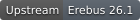
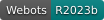
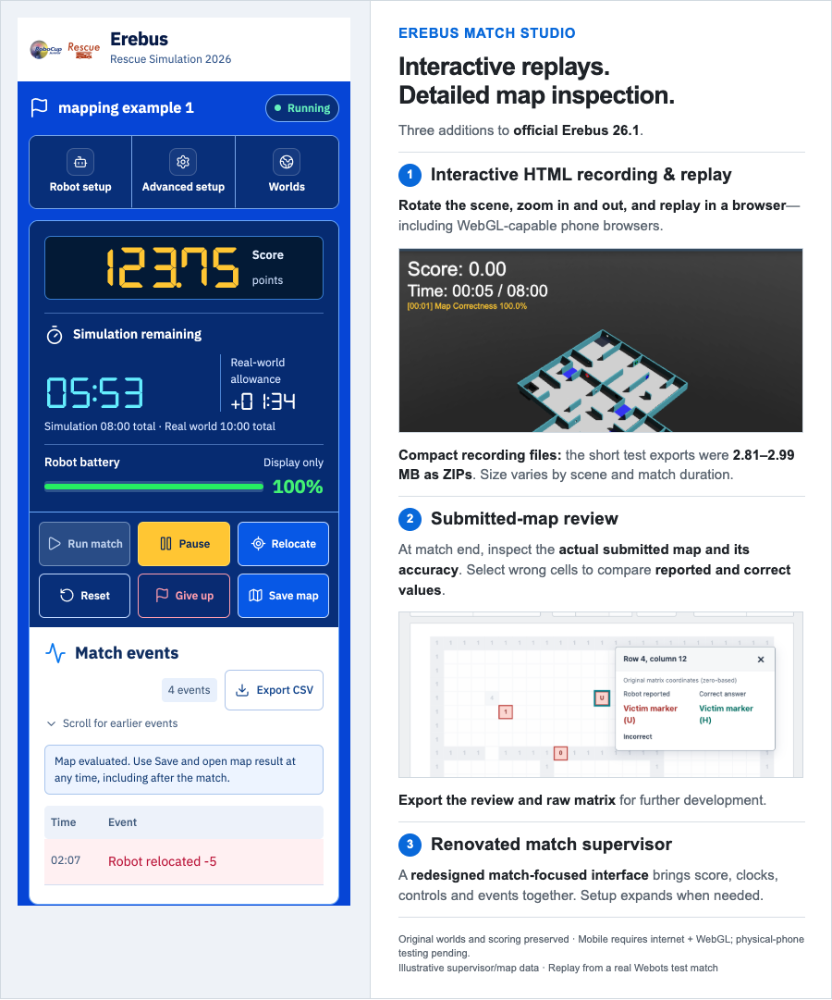
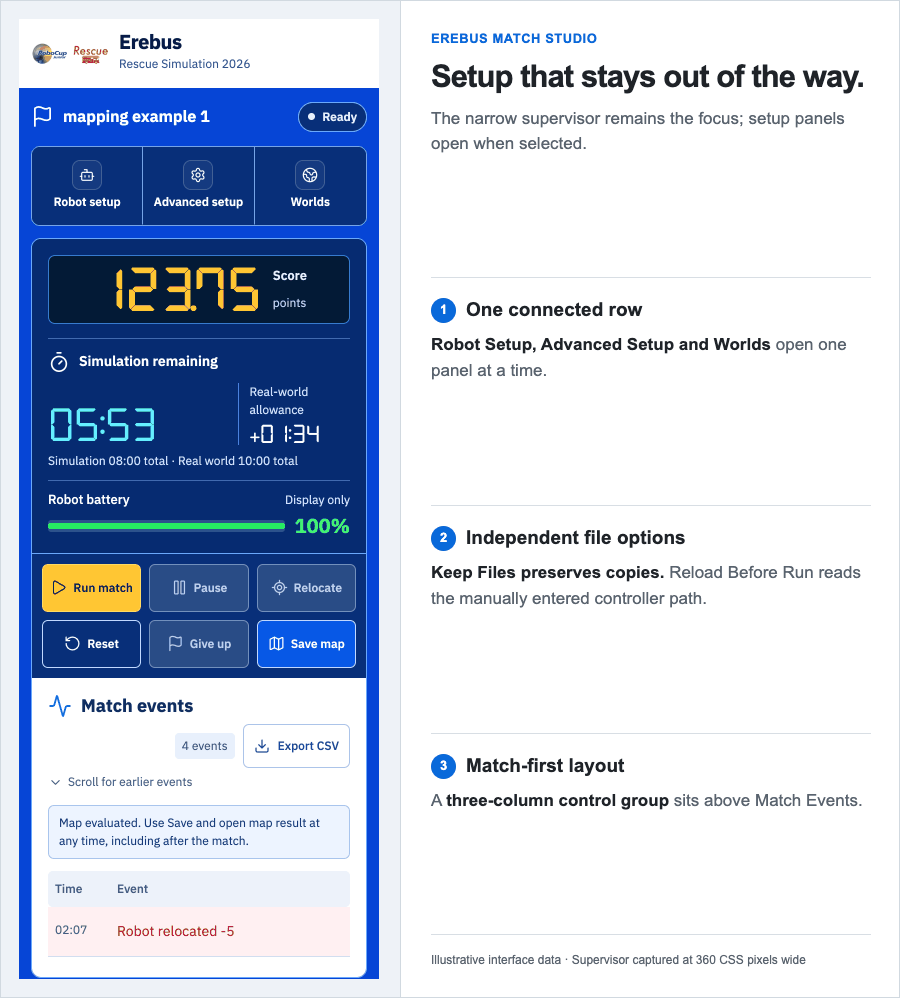
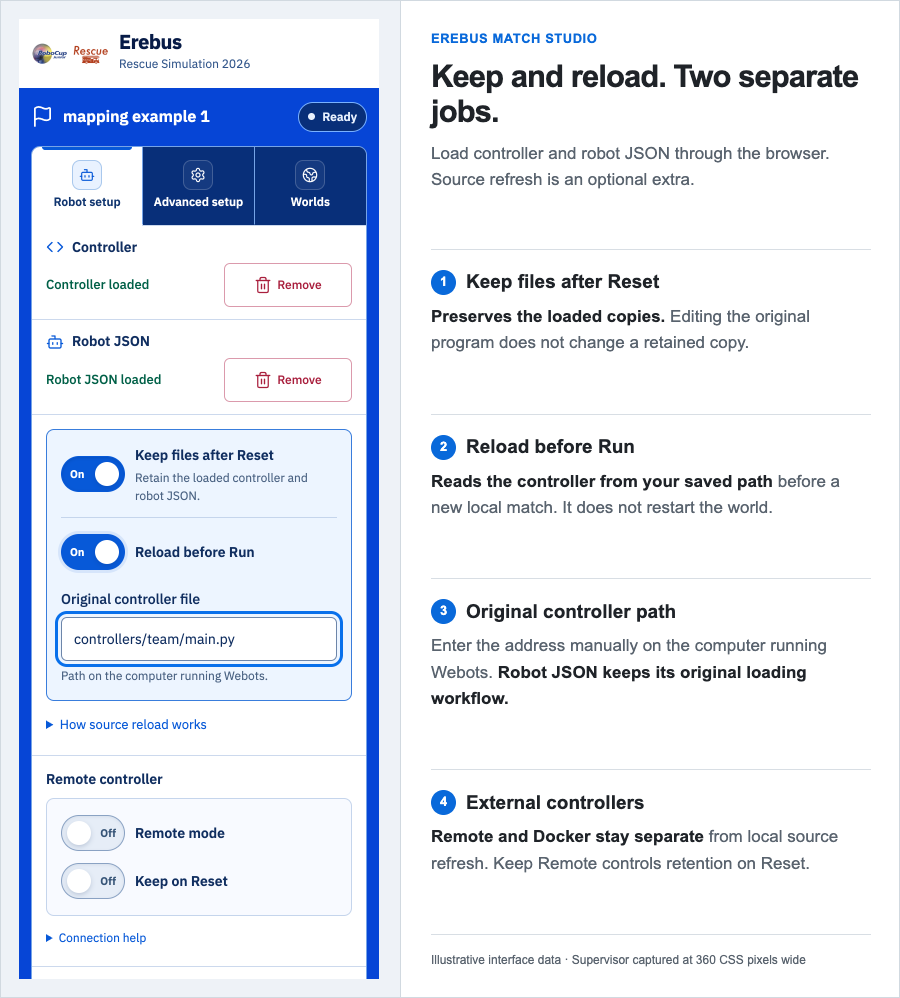
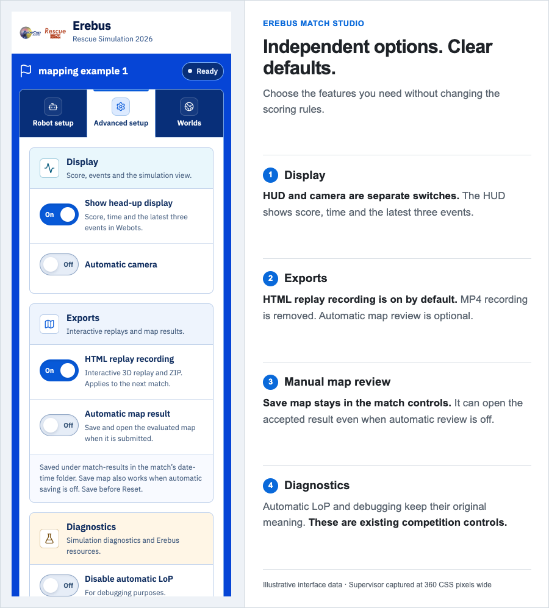
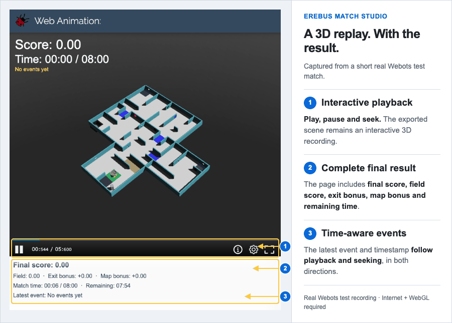
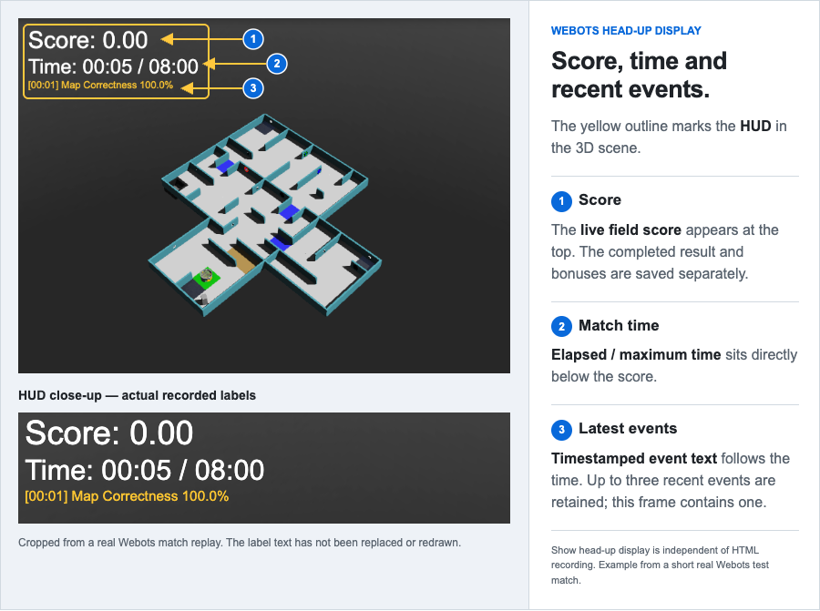
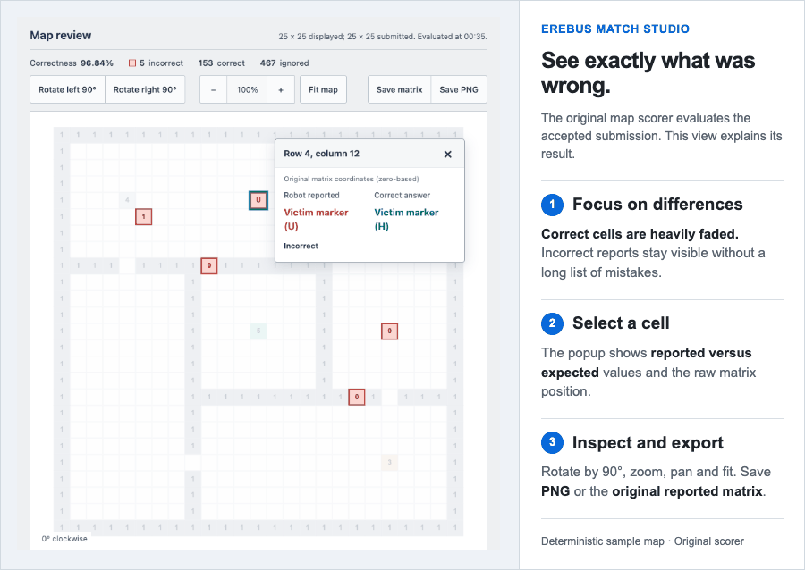
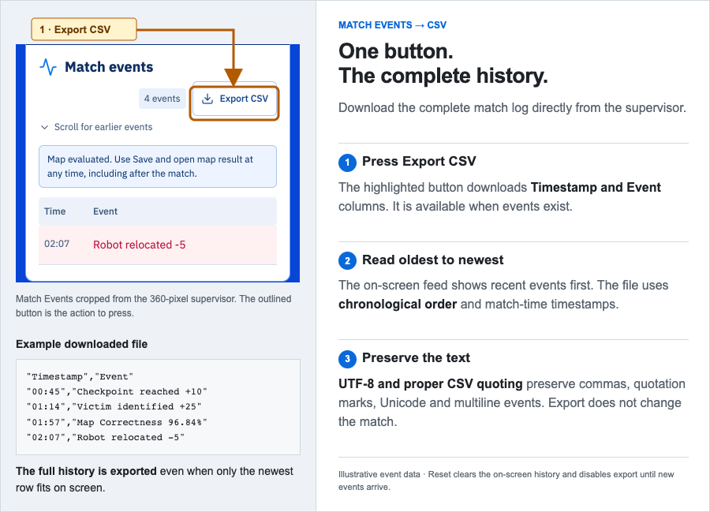

<div align="center">

# Erebus Match Studio

**Interactive HTML replay · Submitted-map review · Renovated match supervisor**

[](docs/releases/26.2-studio.1.md) [](https://github.com/robocup-junior/erebus/tree/v26.1) [](https://cyberbotics.com/) [](#verification-and-limits) [](NOTICE.md)

[Get started](#quick-start) · [What's changed](#changes-from-official-261) · [Changelog](CHANGELOG.md) · [Report an issue](https://github.com/peymanyousefi3/erebus/issues)

</div>

---

This independent fork is maintained by **Peyman Yousefi**. It extends [RoboCupJunior Erebus](https://github.com/robocup-junior/erebus), developed by the Erebus maintainers and contributors, on the [Webots](https://cyberbotics.com/) simulator from Cyberbotics. The original competition environment, scoring rules, world assets and robot examples remain upstream work.

The interface identifies this edition as **26.2**. That is this fork's version, **not an official RoboCupJunior Erebus 26.2 release**. Its exact comparison baseline is [`v26.1`](https://github.com/robocup-junior/erebus/tree/v26.1), commit `a53a7965c8c0c594196aad111b486ca979e063a2`.

[Quick start](#quick-start) · [Changes from 26.1](#changes-from-official-261) · [Match files](#match-files) · [Verification](#verification-and-limits) · [Credits and licensing](#credits-and-licensing)

<p align="center">
  
</p>

<p align="center"><sub>Interactive replay first, submitted-map inspection second, renovated supervisor third</sub></p>

*The supervisor is captured at 360 CSS pixels wide and paired with explanatory annotations. Its narrow layout is preserved inside each figure. Interface screenshots use illustrative match data. The replay GIF and HUD close-up were captured from a short real Webots test match. The map-review example uses a deterministic sample submission.*

## Changes from official 26.1

| Area | Official 26.1 baseline | This edition |
| --- | --- | --- |
| Recording | MP4 recording, with recording-specific countdown and end display | Automatic **interactive HTML replay**, saved before robot removal; no MP4 recording path |
| Match results | Existing match history and scoring output | **Final-score breakdown**, remaining time and **playback-synchronized events** |
| Webots HUD | Labels associated with recording | **Independent HUD switch**, larger score/time labels and **latest three events** |
| Map submissions | Correctness is evaluated by the existing map scorer | **Interactive map review** with **reported vs. expected** values for each selected cell |
| Supervisor interface | Original control panel | **Responsive match console**, connected setup panels, digital readouts and compact references |
| Controller sources | Browser file loading and retained controller copies | **Optional controller-path refresh** before a new match; **Keep Files stays independent** |
| File errors | Original upload/model handling | **Missing/empty file guards**, recoverable JSON errors and safer controller replacement |
| Remote and Docker | Original connection modes | **Remote mode stays unchanged** by unrelated settings; **Docker paths preserve commas**, with duplicate-start protection and visible errors |
| Event export | On-screen history | **Export CSV** for the complete timestamped event history |

**The map-scoring implementation and scoring formulas are unchanged.** The original worlds and example player controllers are retained. This fork does not require changes to a participant's robot controller to record a match, display the HUD or review an accepted map.

## Quick start

### Requirements

- **Webots R2023b**, the version identified by the upstream setup instructions.
- **Python 3.10**, the version used for the tested local workflow.
- A browser with WebGL support. Chrome on macOS was used for the recorded end-to-end checks.
- Internet access when opening an HTML replay: scene and recording data are embedded locally, but the Webots viewer is loaded from Cyberbotics.

Install the Python dependencies with the interpreter configured for Webots:

```sh
python -m pip install -r requirements.txt
```

The requirements file records versions from the tested environment. It is not a claim that every Webots/Python/operating-system combination has been validated.

### Start a match

1. Clone this fork, or download its source ZIP from GitHub, and extract it fully.
2. Run `python scripts/prepare_world.py` once, then open a supplied world such as `game/worlds/mapping_example_1.wbt` in Webots. This creates the ignored initial robot model only if none exists. It never overwrites an existing robot.
3. Open the Main Supervisor robot window and expand **Robot Setup**.
4. Load a supported controller program and the matching robot JSON from the browser file pickers. A compiled controller must match the operating system where Webots runs.
5. Review **Advanced Setup**. HTML recording is on by default; automatic map review and source refresh are off.
6. Press **Run match**. When the robot finishes or the match ends, recording is finalized before the robot is removed.

When replacing an older installation, restart Erebus once so the Python supervisor and HTML panel use the same version. **Starting a new match with source refresh does not automatically reload the world.** The normal Reset action retains upstream world-reset behavior.

Use the [official robot customiser](https://v25.robot.erebus.rcj.cloud/) and [World Editor](https://world.erebus.rcj.cloud/) for compatible input files. The supervisor's References strip also links to the [competition rules](https://junior.robocup.org/rcj-rescue-sim/), documentation, upstream source and changelog.

## Match-focused supervisor

**A renovated supervisor interface keeps score, clocks, match controls and events on the main page.** Robot Setup, Advanced Setup and Worlds share a connected selector row; setup starts collapsed and only one panel opens at a time.

- The score retains decimal values. Score and points labels sit beside the number.
- Simulation remaining time is shown with the additional real-world allowance. The real-world total is also identified.
- Narrow windows use a three-column, two-row match-control group; events follow the controls.
- Setup switches use a fixed column and center against the complete label/description block.
- The battery graphic is a **100% placeholder**. It is not connected to robot telemetry or scoring.
- Open Compact Window requests a separate, resizable browser window. Browser popup rules and the operating system determine whether that request is honored; Webots Show Window is not guaranteed to open a new compact window automatically.

<p align="center">
  
</p>

### Keep Files and Reload Before Run are different

**Keep Files** controls whether the loaded controller and robot JSON copies survive Reset. **Reload Before Run** reads a saved controller program from the manually entered original-file path before a new local match.

<p align="center">
  
</p>

| Keep Files | Reload Before Run | Behavior |
| --- | --- | --- |
| Off | Off | Reset removes loaded copies. Load the controller and JSON again before the next match. |
| On | Off | Retained copies are used. Editing the original controller does not update the loaded copy. |
| Off | On | The controller can be copied from its original path for the next match, but robot JSON still needs normal loading after Reset. |
| On | On | Copies are retained; the controller is refreshed from the original path for each new local match. |

The path is on the **computer running Webots**. Relative paths start in the Erebus project folder. Browser file pickers supply file contents, not a portable original full path, so enter the source path manually when using refresh.

The same formats are supported by browser upload and source refresh: `.py`, `.exe`, `.class`, `.jar`, `.bsg`, `.m`, or an executable without an extension. C/C++ programs must already be compiled. **Pause/resume, Remote mode and Docker do not use local source refresh.** **Robot JSON keeps its normal browser loading workflow.**

A missing or empty local controller, a missing custom robot JSON, or an invalid refresh path produces an error before the local match starts. Python syntax is left to the controller runtime; this fork does not add a separate syntax-prevalidation step.

### Advanced Setup

Display, Exports and Diagnostics use matching section frames. The defaults are:

| Option | Default |
| --- | --- |
| Keep Files | On |
| Reload Before Run | Off |
| HTML replay recording | On |
| Webots HUD | On |
| Automatically save/open map result | Off |
| Automatic camera | Off |
| Keep Remote on Reset | Off |
| Disable automatic LoP / Enable debugging | Off / Off |

The original debugging facilities remain available; they are not temporary development controls added for this fork.

<p align="center">
  
</p>

## Automatic HTML recording

**Record an interactive 3D match, then rotate the scene, zoom in or out and replay it in a browser.** The two short test exports produced **2.81–2.99 MB ZIP archives**; size varies with scene assets, movement and match duration. Their self-contained HTML pages were 3.54–3.65 MB. These are measured examples, not a size guarantee.

Replay can be viewed in a **WebGL-capable phone browser** as well as on a computer. Internet access is required for the viewer. Physical-phone playback and touch gestures have not yet been tested for this fork; see the [Webots animation viewer documentation](https://cyberbotics.com/doc/guide/web-animation).

Enable **HTML replay recording** before starting the match. Recording starts after the robot and initial HUD are ready. On completion, give-up, timeout or reset, the supervisor finalizes the recording before removing the robot.

There is no MP4 recording, recording countdown or artificial post-match display delay. Final score and event metadata are written into the saved output without adding terminal simulation steps. A zero-duration Webots flush applies the initial HUD before the scene export.

The recording contains:

- Interactive 3D playback, with play/pause, timeline seeking and camera movement.
- Final score, field score, exit bonus, map bonus and remaining match time.
- Timestamped events. The latest event follows the playback position, including backward seeking; it does not always show the match's final event.
- A ZIP archive beside the unpacked replay files.



`replay.html` can be opened directly from disk in a supported browser. Keep the complete recording folder for archival and upload. The exported page embeds its scene, animation and local assets; it still needs internet access to load the Webots viewer and a working WebGL implementation.

### Embed a replay on a website

Upload the recording folder, preserve its filenames, and serve its `replay.html` over HTTP(S):

```html
<iframe
  src="/matches/example/recording/replay.html"
  title="Erebus match replay"
  loading="lazy"
  allowfullscreen
  style="width:100%; height:720px; border:0">
</iframe>
```

The final score and synchronized event display are part of the replay page itself. A website may additionally read `match-result.json` for its own score cards. The ZIP contains a `recording/` directory; extract it without flattening that structure. Website-side upload, ZIP extraction and access controls belong to the hosting website, not to this fork.

## Webots HUD

**Show head-up display** controls the simulation's score, elapsed/maximum match time and latest three events. An event stays visible until newer events replace it. The same labels are captured by HTML recording, while final result metadata includes the completed score and event history.

The HUD option is independent of recording. Turning the visible labels off retains transparent timeline labels needed to align saved events with playback time. The close-up below shows the **actual recorded HUD**, with arrows identifying each label. It is cropped from a real Webots match replay, not a reconstructed interface.



## Submitted-map review

**At the end of a match, inspect the actual map data submitted by the robot, its correctness result and exactly which reported cells are wrong.** Compare reported and expected values, then export the review and raw matrix for further development. The view represents the **accepted submission**; it is not a continuously updating map feed.

**The original `MapScorer` still evaluates the accepted map.** This edition adds an explanation of that result rather than a new scoring rule.

- **Correct cells fade; incorrect reports stay prominent.**
- **Select a cell** for its raw matrix position, **reported value**, **expected value** and comparison status. There is no long mistake list.
- Rotate left/right in 90° steps, zoom, fit the map or drag to pan.
- Save a PNG of the review, or export the original reported matrix as JSON.
- The initial view fits the useful map automatically. Only an outer margin that is zero in **both** the reference and reported map is cropped.
- Nonzero content in either map remains visible. Cells outside the scorer's comparison are marked separately as **outside comparison**, not silently counted as scored errors.



**Automatic map result** saves and opens the review when a map is accepted. With that option off, **Save map** still saves and opens the accepted result, including after the robot is removed. The button is unavailable until an evaluated map exists. Repeated saves use the same match folder, and later rejected submissions do not replace the accepted map.

The map page includes its data and interface assets and can be reopened independently. Browser opening uses Python's cross-platform browser handoff; it does not require an operating-system-specific picker or launcher.

## Export match events as CSV

Press **Export CSV** in Match Events to download the complete history with `Timestamp` and `Event` columns, oldest first. Quoted fields, doubled quotation marks, UTF-8 text and CSV record separators preserve commas, quotes, Unicode and multiline events.

Export is available during and after the match when events exist. It does not change the match or send a supervisor command. Reset clears the history and disables export until new events arrive. The timestamp is match time, not wall-clock time.

<p align="center">
  
</p>

## Match files

Each match uses one start-time folder under the project root:

```text
match-results/
└── 2026-10-29_14-30-00-123456/
    ├── recording/                   # When HTML recording is enabled
    │   ├── replay.html
    │   ├── replay.json
    │   ├── replay.x3d
    │   ├── replay.css
    │   ├── replay.jpg
    │   ├── match-result.json
    │   ├── textures/                # Exported local assets, when present
    │   └── 2026-10-29_14-30-00-123456.zip
    └── map/                         # When automatic or manual map save is used
        ├── map-review.html
        ├── map-result.json
        └── reported-map.json
```

Other scene dependencies may also be exported. The recording ZIP packages the recording, not the separate map-review directory. Map and recording options remain independent; unused subfolders are not created merely to fill this layout.

## Source changes at a glance

| Source | Responsibility of the fork changes |
| --- | --- |
| `MainSupervisor.py` | Match lifecycle recording hooks, map-result handling, local Run guards, optional source refresh, command acknowledgements and Docker failure handling |
| `MatchAnimation.py` — new | HTML export, final-result/event metadata, direct-file packaging and recording ZIPs |
| `Recorder.py`, `Robot.py` | HUD labels and event updates; the old MP4 recording path is removed |
| `MapReview.py` — new | Scorer-consistent comparison data, safe zero-margin cropping, raw matrix preservation and map export |
| `Controller.py`, `ControllerUploader.py` | Loaded-copy detection, recognized entrypoints and complete-file replacement shared by upload and source refresh |
| `Config.py`, `config.txt` | Additional independent options, backward-compatible defaults and encoded Docker/source paths |
| `MainSupervisorWindow.html`, `.css`, `.js` | Supervisor layout, controls, CSV export, error states, refresh restoration and references |
| `MapReview.html`, `.css`, `.js` — new | Interactive canvas review, cell popup, rotation, zoom and exports |
| `assets/` | Interface fonts and icon notices |
| `scripts/prepare_world.py` — new | First-checkout preparation of the ignored default robot model; preserves existing custom models |
| `tests/`, `scripts/check_customizations.py`, workflow | Reproducible regression checks for the added behavior |

Upstream `MapScorer`, `MapAnswer`, `Tile`, `Victim`, `ProtoGenerator`, world files and example player controllers are retained. Runtime controller copies, custom robot models, generated target textures, logs, local maps, recordings, cached native binaries and machine-specific settings are not included in this publication.

## Verification and limits

The development checks included **two short real Webots matches** on macOS with Chrome: actual controller upload, original-source refresh on/off, Keep Files across Reset, pause/resume, browser refresh, automatic completion, robot removal, recording/ZIP creation, map saving and missing/invalid JSON recovery. Direct-file replay loading, play/pause and actual timeline seeking were also checked.

Additional isolated tests reproduced and verified the Remote-mode and Docker-message fixes. A failed real Docker-start request returned an error and restored the controls.

Run the portable regression suite:

```sh
python -m pip install -r requirements-dev.txt
python scripts/check_customizations.py
node tests/test_interface_contract.cjs
```

Node is needed only for that interface contract check, not for running Erebus. A workflow is configured for Python 3.10/3.12 on Linux, Windows and macOS; configuration is not evidence of completed workflow runs.

**Not yet verified:** physical-phone playback and touch gestures, successful Docker container startup, Safari, or Windows/Linux Webots runtime behavior. The local test computer had no Docker runtime. Static cross-platform checks and unit tests do not establish full simulator compatibility, accessibility compliance or readiness for every competition environment. Validate the complete setup on the intended referee computer before an event.

## Credits and licensing

- **Original simulator:** [RoboCupJunior Erebus and its contributors](https://github.com/robocup-junior/erebus).
- **Fork modifications and maintenance:** [Peyman Yousefi](https://github.com/peymanyousefi3).
- **Simulation platform:** [Webots by Cyberbotics](https://cyberbotics.com/).
- **Competition rules:** [RoboCupJunior Rescue Simulation](https://junior.robocup.org/rcj-rescue-sim/).
- **Interface assets:** IBM Plex Sans, DSEG, Lucide and original upstream fonts, with their bundled notices retained.

> **Licence status:** official Erebus `v26.1` has no repository-wide licence file. This fork preserves the existing rights and notices; it does not assign MIT, GPL or another blanket licence to upstream work. Public access to this repository is not a new licence grant. See [NOTICE.md](NOTICE.md).

| Component | Attribution / licence notice |
| --- | --- |
| Original Erebus source, worlds and examples | RoboCupJunior Erebus contributors; no project-wide licence supplied at the `v26.1` baseline |
| Fork modifications | Peyman Yousefi; no separate blanket licence is declared in this preview |
| IBM Plex Sans | [SIL Open Font License](game/plugins/robot_windows/MainSupervisorWindow/assets/OFL-IBM-Plex.txt) |
| DSEG digital font | [SIL Open Font License](game/plugins/robot_windows/MainSupervisorWindow/assets/OFL-DSEG.txt) |
| Lucide icons / inherited Feather notices | [ISC and retained notices](game/plugins/robot_windows/MainSupervisorWindow/assets/LICENSE-Lucide.txt) |
| Original interface fonts and Webots assets | Retained bundled or embedded notices; see [NOTICE.md](NOTICE.md) |

This is an independent extension, with no claim of official RoboCupJunior or Cyberbotics endorsement.

## Support and contributing

See the [fork changelog](CHANGELOG.md), [preview release notes](docs/releases/26.2-studio.1.md) and [contributing guide](CONTRIBUTING.md). Report issues with these additions in [this fork](https://github.com/peymanyousefi3/erebus/issues); use the upstream project's channels for issues reproduced without the fork modifications.
