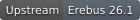
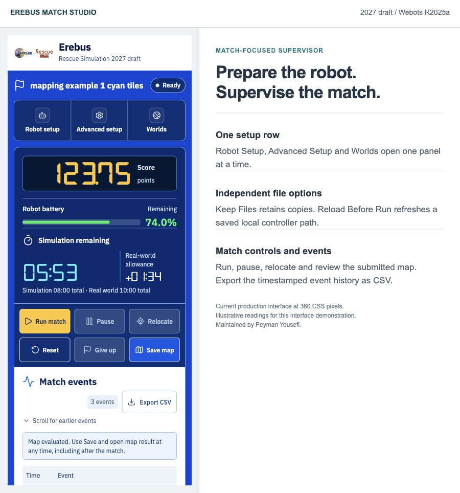
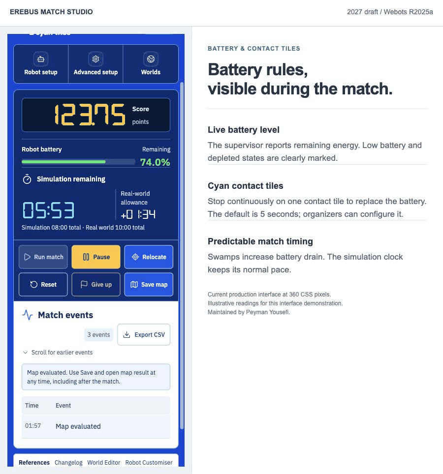
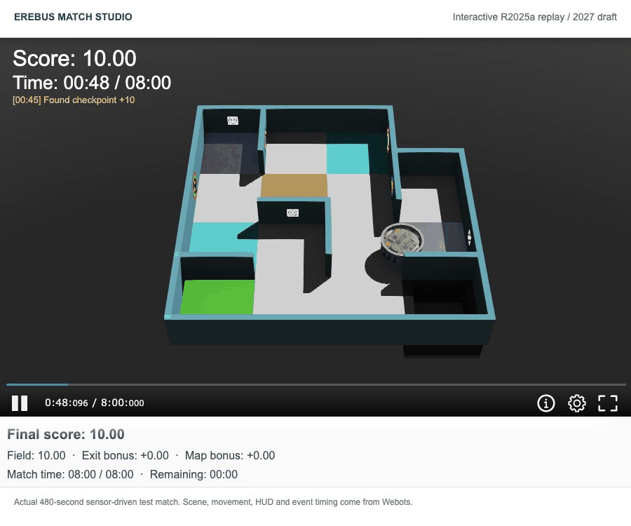
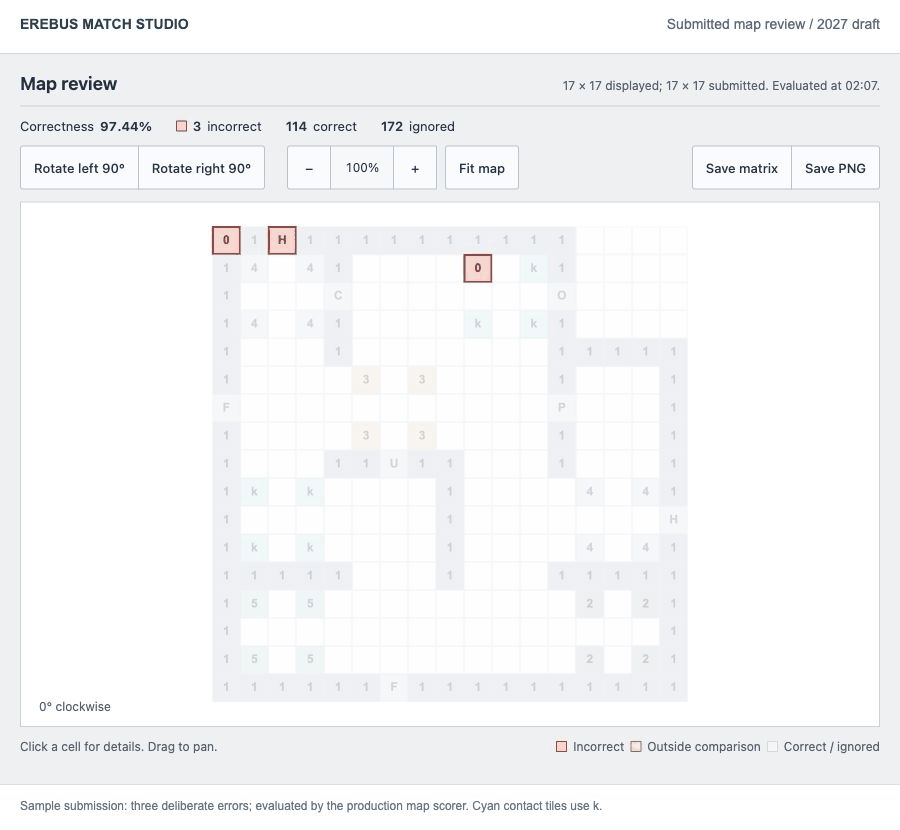

<div align="center">

# Erebus 2027 · Match Studio

**2027 draft rules · Live battery and cyan contact tiles · Interactive match replays**

[](docs/releases/27.0-draft.1.md) [](https://cyberbotics.com/) [](https://github.com/robocup-junior/erebus/tree/v26.1) [](#verification) [](NOTICE.md)

[Get started](#quick-start) · [2027 rules](#2027-rules) · [Match Studio](#match-studio) · [Verification](#verification) · [PDF guide](docs/README-2027.pdf)

</div>

This branch combines the **8 September 2026 Rescue Simulation 2027 draft** with **Match Studio**, the customized Erebus supervisor maintained by **Peyman Yousefi**. It targets **Webots R2025a** on macOS, Windows and Linux.

This is an independent fork of [RoboCupJunior Erebus](https://github.com/robocup-junior/erebus), not an official RoboCupJunior release. The original simulator, worlds, models and competition foundations remain the work of the upstream contributors. Webots is developed by Cyberbotics.



*The setup and battery media use the current production interface with illustrative readings. The replay media comes from an actual R2025a test match. The map demonstration uses a 2027 reference field with three deliberate submission errors evaluated by the production scorer.*

## Choose the right branch

| Branch | Rules and simulator | Purpose |
| --- | --- | --- |
| [`2026_webots2023b`](https://github.com/peymanyousefi3/erebus/tree/2026_webots2023b) | 2026 / Webots R2023b | Preserved 26.2 Match Studio edition |
| **`2027_webots2025a`** | **2027 draft / Webots R2025a** | **This edition: battery rules, contact tiles and Match Studio** |
| [`2028_webots2025a`](https://github.com/peymanyousefi3/erebus/tree/2028_webots2025a) | Future development / R2025a | Separate Robot Designer and component-configuration work; no claim of compliance with unpublished 2028 rules |

The 2027 edition retains the existing robot customizer and its **3,000-point component budget**. The future Robot Designer, selectable motor library and USD budget belong to the separate 2028 development work.

## Quick start

### Requirements

- **Webots R2025a** and **Python 3.10**, with the interpreter selected in Webots preferences.
- The packages in `requirements.txt`.
- A WebGL-capable browser for interactive replay. Replay needs internet access to load the Cyberbotics viewer; saved map review is self-contained.
- Docker Engine or Docker Desktop with a running daemon only if using Docker controllers.

### Open Erebus and run a match

1. Clone this branch, or download and fully extract its [ZIP](https://github.com/peymanyousefi3/erebus/archive/refs/heads/2027_webots2025a.zip):

   ```sh
   git clone --single-branch --branch 2027_webots2025a https://github.com/peymanyousefi3/erebus.git erebus-2027
   cd erebus-2027
   python -m pip install -r requirements.txt
   python scripts/prepare_world.py
   ```

   The preparation command creates the ignored initial robot model if it is missing. It preserves an existing custom model.

2. Open a supplied world in Webots, such as the [cyan-tile example](game/worlds/mapping_example_1_cyan_tiles.wbt) or a `2027_d*r*.wbt` field.
3. Use the Match Studio referee window opened by Erebus. In **Robot Setup**, load a controller and its matching robot JSON. Use the existing **Remote mode** or **Run Docker** controls for external controllers.
4. Review **Advanced Setup**, then press **Run match**. Recording is enabled by default; automatic map review and source refresh are optional.
5. At match end, open the replay, inspect the accepted map and export the event history as needed.

When updating an older installation, restart Erebus and load the robot JSON again to regenerate its R2025a model and energy inventory. A retained model without the required inventory is rejected with a recovery message. Compiled controllers must match their execution platform.

Use the [robot customizer](https://v25.robot.erebus.rcj.cloud/) and [World Editor](https://world.erebus.rcj.cloud/) for input files. Source refresh before a new match does not reload the world; **Reset** retains the normal world-reset behavior.

## 2027 rules

The [official draft PDF](https://junior.robocup.org/wp-content/uploads/2026/09/RCJRescueSimulation2027-draft.pdf) remains the authoritative rule reference. This implementation draws on the [official 2027 R2025a branch](https://github.com/robocup-junior/erebus/tree/147d7a6190b10ebe67385d5836d8f7739c695899) and the [battery reference supplied by sebybritez/Bater-a-PRUEBA](https://github.com/sebybritez/Bater-a-PRUEBA/tree/b0e4aafaf67850cfc1b37fc4ce84235767714f9a).

| Rule area | Behavior in this edition |
| --- | --- |
| Battery consumption | The supervisor measures wheel movement and updates the live battery meter. Additional driven wheels count separately. |
| Cyan contact tiles | Remain continuously stationary on the **same tile for 5 seconds** to replace the battery. Movement, leaving the tile or relocation resets the interval. The duration is organizer-configurable. |
| Swamps | Increase battery consumption; **the match clock keeps its normal pace**. |
| Empty battery | Ends the run. An empty battery cannot be revived by remaining on a contact tile. |
| Victim appearance | **H = harmed/sad, S = stable/neutral, U = unharmed/happy** smileys. Three-dimensional decoys do not score. Victim signs are 20 mm square; cognitive targets are 50 mm across. |
| Token reporting | Requires at least **one second stopped**, with the robot and reported position within **60 mm** of the sign. Wrong-category and duplicate reports are handled by the scoring rules. |
| Mapping | Cyan contact tiles use **`k`**. Map review uses the accepted submission and the same scorer as the supervisor. |
| Match duration | Up to **480 simulated seconds**, with a **600-second real-world limit**. Exit, give-up or battery depletion can end a run earlier. |
| Match ending | Exit eligibility, map bonus and rounding are evaluated by the supervisor. The final map award is applied once; recording is finalized before robot removal. |



*Interface demonstration: battery replacement is shown while energy remains. These illustrative readings are not a measured discharge curve.*

### Organizer battery configuration

Edit [`sensorEnergyConfig.txt`](game/controllers/MainSupervisor/sensorEnergyConfig.txt) in the MainSupervisor folder and restart the supervisor after changing values:

```ini
ChangeBatteryTime = 5
Motor_Drain_Per_Step = 0.02,
Motor_Max_Velocity = 6.28,
Battery_Per_Step = 0.00,
SwampMultiplier = 5
```

`ChangeBatteryTime` accepts 5, 10 or another positive duration. Both 5- and 10-second replacement were tested in the simulator. The inherited motor calibration consumes 0.02 battery percentage points per reference 16 ms at full speed for a two-wheel pair, with a 6.28 rad/s speed reference. Passive and configured sensor rates default to zero.

The draft does not specify a numerical battery calibration or swamp multiplier. **The default swamp multiplier of 5 is an organizer setting.** The implementation retains the draft's explicit mapping formula, **`1 + 1.2 × correctness`**, which reaches 2.2 at full correctness. Its earlier 1-to-2 description conflicts with that formula; this choice follows the explicit formula and reference implementation.

### Competition graphics profile

Set these Webots preferences consistently on competition machines: **Ambient Occlusion Low**, **Texture Quality Low**, **Max Texture Filtering 4**, **Shadows Disabled**, **Anti-aliasing Disabled**. Administrative judging and competition setup remain referee responsibilities.

### Battery in the controller interface

A normal **`G` game-info request** receives a 20-byte packet:

```python
kind, score, simulation_remaining, real_remaining, battery_percent = \
    struct.unpack('c f i i f', packet)
```

Battery percentage is appended to the original fields. Older readers that require exactly 16 bytes need updating. The supplied [`GetGameInfo.py`](player_controllers/GetGameInfo.py) accepts both packet sizes. Reporting victims, sending maps and requesting game information retain their normal roles.

## Match Studio

Match Studio keeps score, battery, clocks, controls and events together. Setup panels open only when selected, leaving the match view compact.

| Feature | What the referee can do |
| --- | --- |
| Match console | Read decimal scores, live battery, simulation remaining time and the real-world allowance. |
| Connected setup panels | Open **Robot Setup**, **Advanced Setup** or **Worlds**; only one panel expands at a time. Search, preview, select and load a bundled field. |
| Match controls | Run, pause, relocate, reset, give up and save the accepted map. |
| Interactive HTML replay | Play, pause, seek, rotate and zoom a recorded 3D match in a browser; share its ZIP and final-score summary. |
| Submitted-map review | Select cells to compare reported and expected values, rotate, zoom, pan, fit, save PNG and export the original matrix. |
| Match events | Follow timestamped events and export the complete history as chronological CSV. |
| Webots HUD | Independently show score, time and the latest three events, including in the replay. |
| File handling | Retain uploaded files after Reset, optionally refresh a local controller source before Run, and recover from missing files or invalid robot JSON. |
| External controllers | Use the existing remote and Docker controls, with visible startup/build errors and duplicate-start protection. |


### Keep Files and Reload Before Run

These switches are independent:

| Keep Files | Reload Before Run | Result |
| --- | --- | --- |
| Off | Off | Reset removes loaded copies; load the controller and JSON again. |
| On | Off | Reuse the retained copies. Editing the original source does not update them. |
| Off | On | Refresh the controller from its saved path for the next match; JSON still uses normal loading after Reset. |
| On | On | Retain the copies and refresh the controller for each new local match. |

The source path belongs to the **computer running Webots**. Relative paths start in the Erebus project folder. Enter it manually: browser file pickers provide contents, not a portable original full path. Robot JSON keeps its normal browser-loading workflow.

Refresh applies to a **new local Run**, not pause/resume, Remote mode or Docker. Supported entries are `.py`, `.exe`, `.class`, `.jar`, `.bsg`, `.m`, or a compiled executable without an extension. C/C++ must already be compiled. Missing or empty sources are reported before the local run; Python syntax errors remain controller-runtime errors.

### Advanced Setup defaults

| Setting | Default |
| --- | --- |
| Keep Files | On |
| HTML replay recording / Webots HUD | On / On |
| Reload Before Run / Automatic map result | Off / Off |
| Automatic camera / Keep Remote on Reset | Off / Off |
| Disable automatic LoP / Enable debugging | Off / Off |

The optional compact-window button requests a separate resizable browser window. Browser popup rules determine whether it opens; Webots Show Window does not guarantee a new compact window.

## Interactive 3D replay

Recording starts after robot setup and the initial HUD are ready. At completion, timeout, give-up or Reset, Erebus finalizes the recording before removing the robot. This edition uses **HTML/W3D replay**, without an MP4 path, recording countdown or artificial post-match delay.



The replay includes the 3D scene and animation, final score, field/exit/map breakdown, remaining time and playback-synchronized events. Rewinding restores the event appropriate to that point; it does not leave the final event displayed.

Open **`recording/replay.html`** directly in a supported browser, or serve it over HTTP(S). Keep the complete recording folder for archival; the accompanying ZIP contains a `recording/` directory. Scene, animation and exported local assets are embedded, but the Cyberbotics viewer still requires internet access and WebGL. Physical-phone playback has not been qualified.

To embed a hosted recording:

```html
<iframe src="/matches/example/recording/replay.html"
        title="Erebus match replay" loading="lazy" allowfullscreen
        style="width:100%;height:720px;border:0"></iframe>
```

A hosting website can read `match-result.json` for score cards. Website uploads, ZIP extraction and access controls belong to the host, not this fork.

## Submitted-map review

Review the **accepted map submission**, its correctness result and each reported-versus-expected cell. This is a saved submission review, not a continuously updating robot map feed.



- Correct cells fade; incorrect reports stay prominent. Nonzero content in either map remains visible.
- Select a cell for its original matrix coordinates, reported value, expected value and comparison status.
- Rotate in 90-degree steps, zoom, pan or fit. Save a PNG or export the untouched reported matrix as JSON.
- Only outer margins that are zero in both maps are cropped. Cells outside the scorer's comparison are marked separately and are not silently counted as scored errors.

**Automatic map result** saves and opens the review when a map is accepted. With it off, **Save map** still works after evaluation, including after robot removal. Repeated saves use the same match folder; rejected later submissions do not replace the accepted result. Save before Reset.

## Events, HUD and saved files

**Export CSV** downloads all events, oldest first, with `Timestamp` and `Event` columns. UTF-8 and CSV quoting preserve commas, quotation marks and multiline entries. It is available during or after a match when events exist; Reset clears the history. Times are match times, not wall-clock timestamps.

The HUD switch is independent of recording. It controls score, elapsed/maximum time and the latest three events in Webots. Turning visible labels off retains the timing information needed to synchronize replay events.

Each match has its own start-time folder:

```text
match-results/<start-time>/
├── recording/
│   ├── replay.html, replay.w3d, replay.json, replay.css, replay.jpg
│   ├── match-result.json
│   ├── textures/                  # When exported
│   └── <start-time>.zip
└── map/
    ├── map-review.html
    ├── map-result.json
    └── reported-map.json
```

Recording and map export are independent. The recording ZIP packages `recording/`, not the separate map folder. Unused subfolders are not created merely to fill this layout.

## Docker controllers

Copy [`docker/controller/`](docker/controller/), replace `robot_controller.py`, and select that project in Robot Setup. It supplies an R2025a Linux/amd64 example. Older containers with R2023b controller libraries need updating.

The existing Docker helper builds the project and supplies `EREBUS_SERVER`, `EREBUS_CONTROLLER_PORT` and `EREBUS_ROBOT_NAME`. The default host is `host.docker.internal`, using the Docker host-gateway mapping; the default port is 1234. If Webots uses another port, set `EREBUS_CONTROLLER_PORT` before starting it. `EREBUS_DOCKER_HOST` can override the address. Daemon, build and controller-start errors are shown in the supervisor.

## Verification

**103 native platform cases passed** in the latest competition qualification:

| Platform | Native cases | Included |
| --- | ---: | --- |
| macOS ARM64 | **34 passed** | 32 core cases plus two final autonomous endurance reruns; Webots minimized |
| Windows Server 2022 | **34 passed** | Official R2025a installer with software OpenGL |
| Ubuntu 22.04 | **35 passed** | Official R2025a package, including the ordinary Docker controller |

Coverage includes **all 14 bundled worlds**, real motor/sensor access, two/four-wheel and camera variants, battery depletion and swamp drain, both **5- and 10-second contact replacement**, pause behavior, map submission, exit/map awards, replay export and **80 valid victim/target reports across five scoring fields**. Separate rule checks cover penalties, report boundaries, map symbols, rotations, score floors and duplicate awards.

Local and remote TCP endurance controllers each ran **480 simulated seconds**. Scoring and timing comparisons matched across the tested platforms. [Machine-readable results](docs/releases/27.0-draft.1-competition-results.json) · [Qualification report](docs/releases/27.0-draft.1-competition-qualification.md) · [Qualification PDF](docs/releases/27.0-draft.1-competition-qualification.pdf).

These are functionality checks, not speed benchmarks or a guarantee for every controller and hardware setup. The endurance entrant is sensor-driven navigation, not a victim-recognition or mapping solver; scoring and mapping were checked separately. TCP tests used separate controller processes on the same host. The 600-second real-world cutoff was checked at its timer boundary, without a ten-minute wait. The Mac test installation retains its pre-existing startup-port repair. Test-host/reload warnings are documented in the report; no simulator ERROR lines occurred. Physical-phone playback and a second physical participant laptop were not tested.

Maintainers can repeat the isolated competition checks with [`tests/webots/run_competition.py`](tests/webots/run_competition.py), using `WEBOTS_HOME` to identify the installation. `--docker` adds the container case. The manual **2027 competition qualification** workflow runs the Windows and Linux suites. These are test tools, not additional steps for referees running normal matches.

## Credits and licensing

- **Original Erebus:** [RoboCupJunior Erebus maintainers and contributors](https://github.com/robocup-junior/erebus), based on [`v26.1`](https://github.com/robocup-junior/erebus/tree/v26.1).
- **Fork modifications and maintenance:** [Peyman Yousefi](https://github.com/peymanyousefi3).
- **2027 reference work:** the official 2027 branch and [sebybritez/Bater-a-PRUEBA contributors](https://github.com/sebybritez/Bater-a-PRUEBA/tree/Webots_2025a).
- **Simulation platform:** [Cyberbotics Webots](https://cyberbotics.com/).
- **Interface assets:** IBM Plex Sans and DSEG under their bundled SIL Open Font Licenses; Lucide and inherited Feather notices under the bundled ISC notices. Original fonts and Webots models retain their notices.

**No blanket MIT, GPL or other licence is assigned to upstream work.** Official Erebus `v26.1` had no repository-wide licence file. Public repository access is not a new licence grant or an endorsement. See [NOTICE.md](NOTICE.md) and the notices under [`assets/`](game/plugins/robot_windows/MainSupervisorWindow/assets/).

[Changelog](CHANGELOG.md) · [Release notes](docs/releases/27.0-draft.1.md) · [Contributing](CONTRIBUTING.md) · [Report an issue in this fork](https://github.com/peymanyousefi3/erebus/issues)
